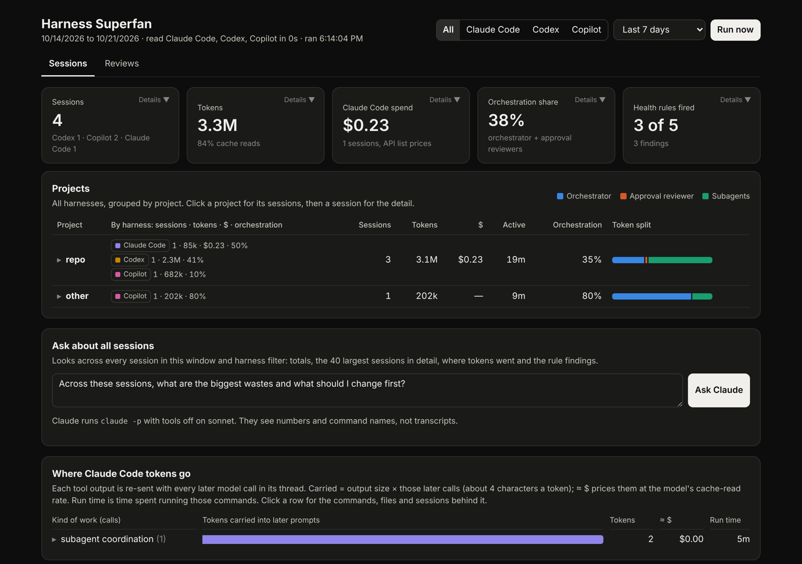
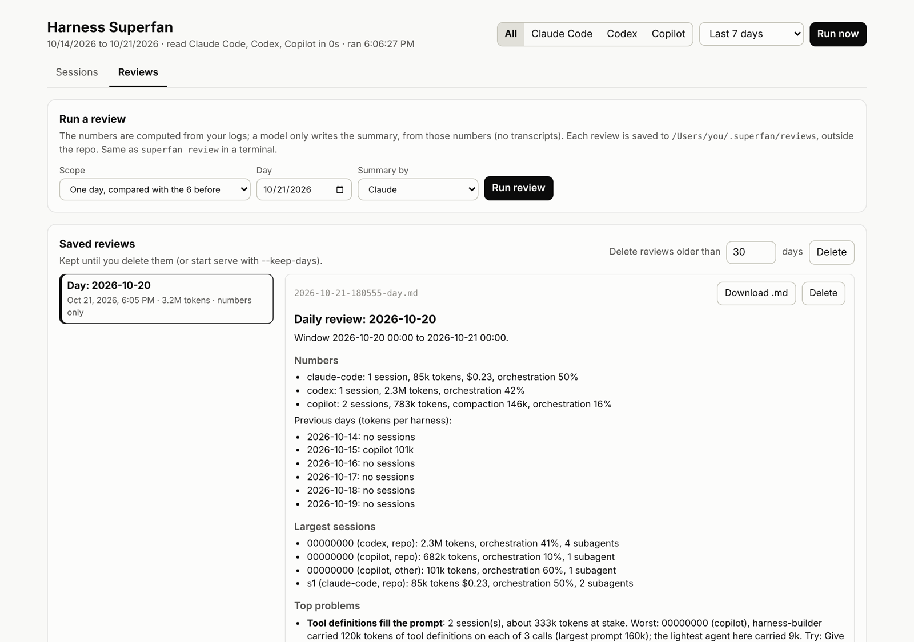

# superfan

Reads the session logs your coding agents leave on disk and tells you, per
session, what it cost and where the tokens went: orchestrator versus each
subagent, model, cache use, tool calls, time. Built to watch runs of the
[Agent Harness Kit](https://github.com/SedyBenoitPeace/agent-harness-kit), but
the parser works on any Claude Code, Codex or GitHub Copilot CLI session.

It also writes **reviews**: one day, one kit run or any window, with the
numbers computed in Python, the top problems ordered by tokens at stake, and
a short summary written by a model from those numbers only. They sit in the
page's Reviews tab, newest first.

**Tested on macOS only. It has not been tested on Linux or Windows.**





*Screenshots run on the synthetic test fixtures, not real sessions.*

## Your data stays on your machine

- It reads only files already on your computer: the session logs Claude
  Code, Codex and Copilot CLI write to `~/.claude/projects`,
  `~/.codex/sessions` and `~/.copilot/session-state`, plus any run reports
  you point it at. No account, no API key, no upload, no telemetry.
- It never changes those files. The one place it writes, and the only place
  it deletes, is its own reviews folder (see Reviews).
- The web page listens on `127.0.0.1` only.
- The one optional exception: **Ask Claude** / **Ask ChatGPT** and the
  review summary call your own `claude` or `codex` CLI, which sends that
  session's numbers and command names (never the transcript) to that model.
  `review --with none` and simply not pressing the buttons keep everything
  local.

Python 3.10+, standard library only, nothing to install.

## Platforms

| | Status |
|---|---|
| macOS | Tested; it is where it runs every day. Automatic reviews use launchd (`examples/launchd`). |
| Linux | **Not tested.** It should work (same Python, same log folders under your home), but nobody has run it there yet. Use cron or a systemd timer for automatic reviews. |
| Windows | **Not tested.** It should work (the three CLIs keep their logs under `%USERPROFILE%`: `.claude\projects`, `.codex\sessions`, `.copilot\session-state`, and `~` resolves there), but nobody has run it there yet, and there is no scheduling example yet (Task Scheduler would do it). |

If you try it on Linux or Windows, an issue saying whether it worked is very welcome.

## Use

```sh
# one JSON row per session for the last 7 days
python3 -m superfan scan --claude ~/.claude/projects --codex ~/.codex/sessions \
  --copilot ~/.copilot/session-state --days 7 --out sessions.json

# the 5 largest, as a Markdown table (--by cost for Claude Code dollars)
python3 -m superfan top sessions.json --n 5

# health rules (see below); --reports takes the kit's docs/runs folders, a
# project folder, or a folder of projects (every <project>/docs/runs inside);
# --tz the UTC offset their local times are in
python3 -m superfan check --codex ~/.codex/sessions --reports ~/src/app/docs/runs --tz +02:00
```

### Web page

```sh
python3 -m superfan serve --reports ~/src ~/work   # folders of projects
```

Opens `http://127.0.0.1:8765` with a **Refresh** button (re-reads the logs for the current window and keeps the filter; a run older than 5 minutes refreshes on page load), a window picker
(24 hours to 90 days) and a harness filter (All, Claude Code, Codex, Copilot) that
applies to the whole page:

- Summary cards; click one for its detail (sessions per day, token mix and
  models, Claude Code spend by token kind, model and project, tokens by role,
  every health-rule finding).
- Under All, sessions grouped by project with per-harness numbers; under one
  harness, a flat list. Click a session for its agents, where its tokens went,
  its largest tool outputs and **What to improve** (rule-based suggestions).
  Click a kind of work (reading files, git...) for the files and commands
  behind it: which agents ran them, how often the same agent re-read a file,
  the largest output, tokens carried and a **Try:** hint for each. Click a
  large output for the full command and its hint. Paths are shortened to
  their last two parts.
- **Ask Claude** on a session runs `claude -p` with every tool off and no
  saved session; **Ask ChatGPT** runs `codex exec` (your Codex login) in a
  read-only sandbox from an empty temporary folder, with `--ephemeral` when
  the CLI has it. Both get that session's numbers and command names, never
  the transcript. `--ask-model` and `--ask-codex-model` pick the models.
  Questions asked this way never show up as sessions in the page. The same
  two buttons on the home page ask across every session in the window and
  harness filter (totals, the 40 largest sessions, the breakdown, findings).
- **Reviews** tab: run a review of one day, one run or a custom window (see
  below), and read the saved ones, newest first, with Download .md and
  Delete, plus "delete reviews older than N days".
- **Where tokens go**, one card per harness; click a kind of work for the
  commands and files behind it, the sessions, and the largest single outputs.

It reads `~/.claude/projects`, `~/.codex/sessions` and
`~/.copilot/session-state` by default (`--claude ''`, `--codex ''` or
`--copilot ''` turns one off). It listens on 127.0.0.1 only,
refuses other Host headers, needs a custom header on anything that does work
(so other websites can't trigger it), and keeps the last result in memory.
The only files it writes are reviews. `python3 -m superfan report` prints the overview in the
terminal.

Each session row has: `harness`, `project` (working folder name), `models`,
`tokens` {`input` (fresh), `cache_read`, `cache_write`, `output`, `total`},
`cost_usd` (Claude Code only; Codex and Copilot stay tokens only), `active_s`
(time with no gap over 10 minutes) and `duration_s` (wall), `model_calls`,
`tool_calls` and `tools`, `orchestration_share`, and `agents[]` with the same
fields per orchestrator, subagent and approval reviewer. Copilot sessions
also have `compactions`, `compaction_tokens` (tokens context compaction used;
included in `tokens`) and, per agent, `tool_def_tokens` (the tool-definition
block re-sent with every call).

Dollars use `superfan/prices.json` (Anthropic API list prices). On a
subscription that is the API-equivalent value, not your bill. Pass
`--prices` to use your own table.

## Reviews

```sh
python3 -m superfan review --day                 # today, compared with the 6 days before
python3 -m superfan review --day 2026-10-15
python3 -m superfan review --run ~/src/app/docs/runs/2026-10-15-1417.md   # one run, plus R2
python3 -m superfan review --since 2026-10-13 --until 2026-10-15T12:00
```

Python computes every number: totals per harness (dollars for Claude Code
only), the largest sessions, the top 3 problems (the page's "What to improve"
tips, grouped across sessions and ordered by tokens at stake), the health
rules, and for `--run` whether the run report agrees with the logs. A model
then writes a short summary from those numbers only: `claude -p` with every
tool off by default, `--with codex` for ChatGPT, `--with both` for a second
opinion, `--with none` for numbers only. It never sees a transcript, and if
the model is missing the numbers are still saved.

Each review is saved as `<date-time>-<scope>.md` plus a `.json` of the
numbers in `~/.superfan/reviews` (or `$SUPERFAN_REVIEWS`, or `--reviews DIR`).
Keep that folder outside any repository: reviews describe your own sessions
and projects. Delete one from the page, or old ones with
`superfan review --prune 30` or the page's "older than N days". `--keep-days N`
(on `review` and `serve`) deletes reviews older than N days after each new
one; it is off by default. Deleting only touches files named like a review
in that folder, never logs or run reports. The page's Reviews tab runs the same command and lists the
same folder. Its run report picker names the assistant behind each run (Claude Code,
Codex or Copilot), from the sessions in that project during the report's
window; a run review only counts that project's sessions.

### Automatic reviews (optional, macOS)

The repo has no schedule; reviews run when you ask. To run them on their own,
`examples/launchd/` has two launchd agents with placeholder paths:

- `com.example.superfan.daily.plist`: `review --day` every evening at 21:00.
- `com.example.superfan.runs.plist`: watches your projects' `docs/runs`
  folders and runs `review --run latest` when a report appears. `latest`
  takes the newest report and skips it if it was already reviewed.

Copy one to `~/Library/LaunchAgents/`, replace every `/PATH/TO/...` and
`YOUR-NAME` (set `PATH` so launchd finds `claude` and `codex`), then
`launchctl load ~/Library/LaunchAgents/<file>`. `launchctl unload` turns it
off. Keep your filled-in copies out of the repo. On Linux, a cron line or a
systemd timer running the same command does the same job.

## Health rules

| Rule | Fires when | Default |
|---|---|---|
| R1 orchestrator share | orchestrator plus approval reviewers take more than X% of a session with subagents | 40%, sessions over 1M tokens |
| R2 report matches logs | a kit run report has negative or blank numbers, an `unknown` model, or totals more than 10% away from the logs for the same window | 10% |
| R3 large tool output | one tool output is at least N tokens, so every later call in that thread pays for it again | 8,000 tokens |
| R4 frequent compaction | one agent compacts its context N times or more (Copilot logs this; Claude Code and Codex never fire) | 5 compactions |
| R5 tool definitions | one agent sends N tokens or more of tool schemas with every call, usually because it loads every tool up front instead of searching for the ones it needs (Copilot) | 50,000 tokens |

Each finding names the session, the agent, the tokens and why it matters.

## Where tokens go

`superfan.breakdown` (`codex_outputs`, `claude_outputs`, `copilot_outputs`, `summarise`) groups
tool calls by kind of work and estimates the tokens each kind keeps in
context: output size times the model calls that follow it in the same
thread. It is an estimate (characters / 4, no compaction). A call is grouped
first by its tool name (`TOOL_CATEGORIES`: Read, apply_patch, spawn_agent,
MCP tools...), then a shell call by its first command (`DEFAULT_CATEGORIES`:
kit scripts, skills and agent docs, reading files, simulator, build, git...).
Both are ordered regular expressions you can replace. Claude Code outputs
also get a dollar estimate at the model's cache-read price.

## Formats

See [docs/formats.md](docs/formats.md) for what each log looks like and the
traps (Codex subagent files that start with a copy of the parent's history;
Claude Code responses split over several lines with the same usage).

## Tests

```sh
python3 -m unittest discover tests
```

Fixtures are synthetic. The Copilot one is hand-made. The Codex ones come from the Agent Harness Kit's test
data (MIT). Never commit a real session log, trimmed or not.

## Not yet

Codex `.jsonl.zst` archives; R2 for Claude Code runs;
Windows scheduling examples.

## License

MIT, see [LICENSE](LICENSE).
